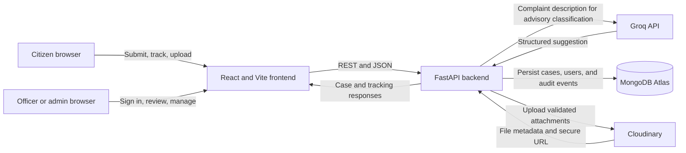
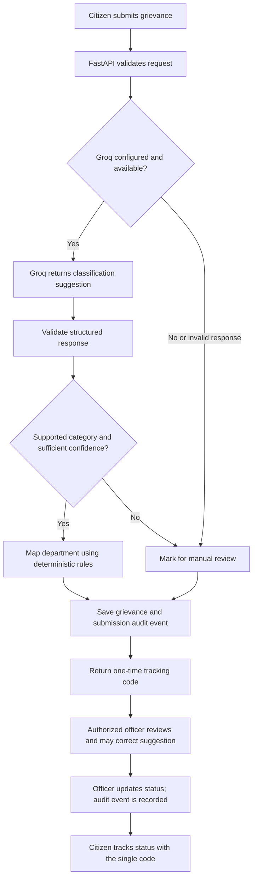

# AI-Powered Grievance Management System

A prototype web application for submitting and managing public grievances in a hypothetical Indian district administration. Citizens can submit and track a case; authorized officers can review, update, and audit cases. Groq provides advisory classification, while department assignment remains deterministic.

> **Prototype notice:** This project uses synthetic data and is not connected to actual government systems. It has not been prepared or audited as a production service.

## Project Overview

District administrations receive complaints across multiple departments and need a consistent way to capture submissions, route them for review, communicate progress, and preserve decision history. This prototype provides a shared intake and case-management workflow:

1. A citizen submits a complaint and receives a single private tracking code.
2. The backend requests an AI classification when Groq is configured, then maps a supported category to a department using fixed rules.
3. Authorized staff view cases within their access scope, record approved values, and update case status.
4. Citizens use the tracking code to see limited status and timestamp information.

AI output is advisory only. Authorized staff retain responsibility for case decisions.

## Key Features

- Public citizen grievance submission with input validation.
- AI-assisted category and subcategory classification.
- AI-generated complaint summary and suggested priority.
- Confidence estimate and explanation accompanying the suggestion.
- Deterministic category-to-department recommendation.
- Officer review and corrections stored separately from AI suggestions.
- Citizen tracking using one random, grievance-specific tracking code.
- PDF, JPG/JPEG, and PNG supporting-document uploads through Cloudinary.
- Audit events for grievance submission, review, status changes, and document uploads.
- JWT authentication and role/department-based staff access control.
- Administrator account creation for officers and administrators.

## AI Capabilities

| Capability | Implementation |
|---|---|
| Provider | Groq through its OpenAI-compatible API, using the `openai` Python SDK. |
| Model | Configurable with `GROQ_MODEL`; the configured default is `openai/gpt-oss-20b`. |
| Category and subcategory | Groq returns a supported category and optional subcategory in a strict JSON-schema response. |
| Summary | Groq generates a concise complaint summary. |
| Priority | Groq suggests `low`, `medium`, `high`, or `critical`; this does not set an official decision. |
| Confidence and explanation | Groq supplies a 0–1 confidence estimate and a short explanation. The estimate is not a calibrated probability. |
| Department | Backend rules map supported categories to an illustrative department. The model does not select the department. |
| Human review | AI suggestions and officer-approved values are stored separately. |
| Fallback | Provider failures, unsupported/unmapped categories, and confidence below the configured threshold result in `manual_review`; submission is designed to continue when classification fails. |

The backend validates the structured response against Pydantic models. Transient HTTP 429 and 5xx errors are retried up to two times with exponential backoff; authentication and invalid-model errors are not retried. The complaint description is sent to Groq for classification. Do not send sensitive or real citizen information to this prototype.

The presence of an integration in source code does not guarantee provider availability. No live provider request is made by installation or startup commands. A successful provider request is only established when a synthetic grievance submission completes classification at runtime.

## System Architecture



## Application Workflow



## Technology Stack

| Area | Technology |
|---|---|
| Frontend | React 18, Vite 5, JavaScript, Bootstrap 5, React Router, Axios |
| Backend | Python 3.11, FastAPI, Pydantic 2 |
| Database | MongoDB Atlas through PyMongo |
| AI provider | Groq API through the OpenAI-compatible endpoint and `openai` SDK |
| Authentication | JWT (`PyJWT`) and Argon2 password hashing |
| Document storage | Cloudinary |

## Project Structure

```text
.
├── .github/                 # Project instructions, agent profiles, and skills
├── backend/
│   ├── app/
│   │   ├── api/             # FastAPI authentication, grievance, and health routes
│   │   ├── core/            # Environment-backed settings
│   │   ├── database/        # MongoDB client, collection operations, and indexes
│   │   ├── models/          # Pydantic domain and persistence models
│   │   ├── schemas/          # API request and response schemas
│   │   ├── services/        # AI, auth, routing, upload, and case workflow logic
│   │   ├── bootstrap_admin.py
│   │   ├── seed_admin.py
│   │   └── main.py           # FastAPI app and startup lifecycle
│   ├── tests/                # Pytest test modules
│   ├── .env.example          # Backend configuration template
│   └── requirements.txt      # Python dependencies
├── frontend/
│   ├── src/
│   │   ├── components/       # Shared interface components
│   │   ├── context/          # Authentication/session state
│   │   ├── layouts/          # Authenticated application shell
│   │   ├── pages/            # Citizen, staff, and admin screens
│   │   ├── services/         # HTTP API client
│   │   ├── App.jsx           # Routes and route guards
│   │   └── main.jsx          # React entry point
│   ├── .env.example          # Frontend API-origin template
│   ├── package.json          # Scripts and dependencies
│   └── vite.config.js        # Vite configuration (port 5173)
└── README.md
```

Important backend entry points include `backend/app/api/grievances.py`, `backend/app/api/auth.py`, `backend/app/services/ai_classification.py`, `backend/app/services/grievance_management.py`, `backend/app/services/department_mapping.py`, and `backend/app/core/config.py`.

## Prerequisites

- Python 3.11 (also required for the standard-library `StrEnum` used by the backend).
- Node.js 18 or newer and npm (Vite 5 frontend).
- A MongoDB deployment with transaction support. The application is configured for MongoDB Atlas.
- Groq API credentials for provider-backed classification. The backend can mark submissions for manual review when classification is unconfigured or fails.
- Cloudinary credentials if document upload is required.

## Installation and Setup

### 1. Clone the repository

```powershell
git clone https://github.com/deepak-05dktopG/ai-grievance-management-system.git
Set-Location .\ai-grievance-management-system
```

### 2. Configure the backend

Create a Python virtual environment and install the dependencies declared in `backend/requirements.txt`:

```powershell
py -3.11 -m venv backend\.venv
.\backend\.venv\Scripts\Activate.ps1
python -m pip install -r backend\requirements.txt
Copy-Item backend\.env.example backend\.env
```

Edit `backend/.env` and add your own MongoDB Atlas, Groq, Cloudinary, and JWT values as needed. Do not commit this file.

### 3. Configure the frontend

```powershell
Set-Location .\frontend
npm install
Copy-Item .env.example .env
```

Set `VITE_API_BASE_URL=http://127.0.0.1:8000` in `frontend/.env`. Variables prefixed with `VITE_` are included in browser code; never put secrets in them.

## Environment Variables

Backend settings are loaded from `backend/.env` using a path resolved from the backend source, not from the shell's current directory. Values below are examples/placeholders; replace them with your own configuration.

| Variable | Required | Default / example | Purpose |
|---|---:|---|---|
| `MONGODB_URI` | Yes for database-backed workflows | `mongodb+srv://<user>:<password>@<cluster>/<db>?retryWrites=true&w=majority` | MongoDB connection string. |
| `MONGODB_DB_NAME` | Yes for database-backed workflows | `creditfix_prototype` | Database name. |
| `MONGODB_SERVER_SELECTION_TIMEOUT_MS` | No | `5000` | MongoDB server-selection timeout; configured range is 100–30000 ms. |
| `GROQ_API_KEY` | For provider-backed classification | `<your-groq-api-key>` | Groq API key. Keep it server-side. If absent or invalid, classification cannot complete and cases require manual review. |
| `GROQ_MODEL` | No | `openai/gpt-oss-20b` | Groq model identifier. |
| `GROQ_CONFIDENCE_THRESHOLD` | No | `0.65` | Minimum model-estimated confidence accepted for automatic classification completion; range 0–1. |
| `GROQ_TIMEOUT_MS` | No | `15000` | Provider request timeout; configured range is 1000–120000 ms. |
| `CLOUDINARY_CLOUD_NAME` | For document uploads | `<your-cloud-name>` | Cloudinary account cloud name. |
| `CLOUDINARY_API_KEY` | For document uploads | `<your-cloudinary-api-key>` | Cloudinary API key. |
| `CLOUDINARY_API_SECRET` | For document uploads | `<your-cloudinary-api-secret>` | Cloudinary API secret. |
| `JWT_SECRET_KEY` | For staff authentication | `<random-secret-at-least-32-characters>` | JWT signing secret; the application requires at least 32 characters. |
| `JWT_ACCESS_TOKEN_MINUTES` | No | `30` | JWT lifetime in minutes; configured range is 1–1440. |
| `SEED_ADMIN_NAME` | Only for seed command | `Demo Administrator` | Initial name for `app.seed_admin`. |
| `SEED_ADMIN_EMAIL` | Only for seed command | `admin@example.test` | Unique email for `app.seed_admin`. |
| `SEED_ADMIN_PASSWORD` | Only for seed command | `<unique-password-12-to-128-characters>` | Password for the seed admin; never place real credentials in a committed file. |

The frontend reads:

| Variable | Required | Example | Purpose |
|---|---:|---|---|
| `VITE_API_BASE_URL` | No for same-origin default; recommended for local setup | `http://127.0.0.1:8000` | Backend origin used by Axios. Must not contain secrets. |

Generate a JWT secret locally without putting it into source control:

```powershell
python -c "import secrets; print(secrets.token_urlsafe(48))"
```

MongoDB configuration is needed for normal application workflows. The backend may start without it, but the health endpoint reports a degraded state and database-backed endpoints are unavailable. Groq and Cloudinary are independently optional until their respective features are used.

## Running the Application

Start the backend and frontend in separate PowerShell terminals. Stop any previous server in its own terminal with `Ctrl+C` before restarting it.

**Backend terminal:**

```powershell
Set-Location .\backend
.\.venv\Scripts\python.exe -m uvicorn app.main:app --reload --host 127.0.0.1 --port 8000
```

**Frontend terminal:**

```powershell
Set-Location .\frontend
npm run dev
```

The frontend `.env` should point `VITE_API_BASE_URL` to `http://127.0.0.1:8000`.

| Page / service | URL |
|---|---|
| Citizen portal | `http://127.0.0.1:5173/` |
| Staff login | `http://127.0.0.1:5173/login` |
| Staff dashboard | `http://127.0.0.1:5173/dashboard` |
| Admin user management | `http://127.0.0.1:5173/dashboard/users` |
| Backend health | `http://127.0.0.1:8000/health` |
| Interactive API docs | `http://127.0.0.1:8000/docs` |

The development CORS configuration allows `http://127.0.0.1:5173` and `http://localhost:5173`. It is not a production CORS policy.

### Optional build and test commands

Create a frontend production bundle from `frontend/`:

```powershell
npm run build
```

Run the backend test suite from `backend/`:

```powershell
python -m pytest
```

The classification/API test modules currently contain legacy Gemini-specific references. Review and update those tests before treating them as validation of the Groq provider.

### Create the first administrator

From `backend/`, run the interactive command. It prompts for the password without echoing it and refuses to create another first administrator if one already exists:

```powershell
python -m app.bootstrap_admin
```

For a repeatable synthetic demo admin, set `SEED_ADMIN_NAME`, `SEED_ADMIN_EMAIL`, and `SEED_ADMIN_PASSWORD` in the ignored `backend/.env`, then run:

```powershell
python -m app.seed_admin
```

The seed command creates a missing account and does not reset an existing admin password. Keep the configured seed password private.

## API Documentation

All API routes are defined under `/api/v1` except `/health`. Staff endpoints use a bearer JWT unless stated otherwise. Citizen tracking uses the `X-Citizen-Tracking-Code` header. The one-time code returned at submission is also used for citizen document uploads through `X-Citizen-Access-Token`.

### Health

| Method | Endpoint | Purpose | Authentication |
|---|---|---|---|
| `GET` | `/health` | Report application and MongoDB availability; may return `503` when the database is unavailable. | Public |

### Authentication

| Method | Endpoint | Purpose | Authentication |
|---|---|---|---|
| `POST` | `/api/v1/auth/login` | Verify credentials and return a JWT and public user profile. | Public |
| `GET` | `/api/v1/auth/me` | Return the current authenticated user. | Staff JWT |
| `POST` | `/api/v1/auth/users` | Create an officer or administrator account. | Admin JWT |

### Grievances

| Method | Endpoint | Purpose | Authentication |
|---|---|---|---|
| `POST` | `/api/v1/grievances` | Submit a grievance; returns its reference and one-time tracking code. | Public |
| `GET` | `/api/v1/grievances/track` | Return limited case status, review flag, and timestamps. | Tracking code in `X-Citizen-Tracking-Code` |
| `GET` | `/api/v1/grievances/{reference_id}/track` | Legacy tracking route retained for earlier submissions. | Earlier citizen token in `X-Citizen-Access-Token` |
| `GET` | `/api/v1/grievances` | List/filter cases with pagination; officers are limited to their department. | Staff JWT |
| `GET` | `/api/v1/grievances/{reference_id}` | Retrieve a case subject to staff role/department access. | Staff JWT |
| `PATCH` | `/api/v1/grievances/{reference_id}/review` | Record officer-approved category/subcategory/priority/department separately from AI output. | Staff JWT, department access enforced |
| `PATCH` | `/api/v1/grievances/{reference_id}/status` | Change status if the transition is allowed by backend rules. | Staff JWT, department access enforced |
| `GET` | `/api/v1/grievances/{reference_id}/audit-logs` | Retrieve the case audit trail. | Staff JWT, department access enforced |

### Documents

| Method | Endpoint | Purpose | Authentication |
|---|---|---|---|
| `POST` | `/api/v1/grievances/{reference_id}/documents` | Upload one PDF, JPG/JPEG, or PNG attachment up to 5 MB. | Staff JWT with case access, or citizen access code |

The status values defined by the backend are `SUBMITTED`, `UNDER_REVIEW`, `IN_PROGRESS`, `RESOLVED`, `REJECTED`, and `CLOSED`. Allowed transitions are enforced server-side; for example, a submitted case can move to `UNDER_REVIEW` or `REJECTED`, but not directly to `RESOLVED`.

## User Roles and Permissions

| Role | Actual access |
|---|---|
| Citizen | Submit a grievance without an account. A submission's private tracking code permits limited tracking and uploads only for that grievance, until expiry (30 days). |
| Officer | Authenticate with JWT; list, retrieve, review, update status, view audit history, and upload documents only for cases in the officer's effective assigned department. |
| Admin | Authenticate with JWT; access all grievances and create officer/admin accounts. The API does not provide a user-list endpoint. |

The backend enforces authorization; the frontend route guards are not the security boundary.

## Database Design

The application uses these MongoDB collections:

| Collection | Contents |
|---|---|
| `grievances` | Citizen details, complaint, AI suggestion, AI processing status, deterministic department recommendation, separate officer-approved values, workflow status, supporting-document metadata, reference ID, timestamps, and a hash/expiry for the citizen tracking code. |
| `users` | User name, normalized unique email, Argon2 password hash, role, optional department, active flag, and creation timestamp. |
| `audit_logs` | Grievance reference and ObjectId, event action, actor type/ID, previous/new values, and event timestamp. |

Audit records relate to a grievance through its MongoDB ObjectId and public reference ID. Grievance submission and staff review/status changes use MongoDB transactions. The startup process creates unique/reference and query indexes. Use a MongoDB deployment that supports transactions.

## Security

- Staff authentication uses JWT bearer tokens with a configured issuer, expiry, and HS256 signing key.
- Passwords are hashed with Argon2; password hashes are not included in user API responses.
- Staff authorization is enforced by backend dependencies and grievance department checks.
- Citizen tracking codes are returned once, stored as SHA-256 hashes, and expire after 30 days.
- Pydantic validates incoming API payloads and model output. File uploads enforce size, extension, MIME type, and file signature.
- Important grievance actions are persisted in the audit collection.
- Secrets belong in ignored backend `.env` files and must not be committed or placed in `VITE_` variables.
- The prototype's development CORS allowlist and local-server setup are not suitable for public production deployment.

## Screenshots and Demo

Add genuine screenshots at these paths when available; the placeholders below are not screenshots.

### Citizen portal


Expected file: `docs/screenshots/citizen-portal.png`

### Officer dashboard


Expected file: `docs/screenshots/officer-dashboard.png`

### Grievance details and AI suggestions


Expected file: `docs/screenshots/grievance-details-ai-suggestions.png`

### Admin user management


Expected file: `docs/screenshots/admin-user-management.png`

## Sample AI Input and Output

**Synthetic input:**

> “There is a large pothole near the community park entrance. It has been there for several weeks and vehicles are swerving around it.”

**Illustrative example only — not a guaranteed Groq response:**

```json
{
  "category": "Roads and Infrastructure",
  "subcategory": "Road pothole",
  "summary": "A pothole near the community park entrance has remained unrepaired for several weeks and is affecting passing vehicles.",
  "suggested_priority": "medium",
  "confidence": 0.88,
  "explanation": "The complaint describes road damage that may create a traffic hazard."
}
```

The backend separately maps `Roads and Infrastructure` to the configured illustrative Public Works department. The confidence number above is invented solely for this example and is not a calibrated probability.

## Known Limitations

- This is a prototype for an assessment and should be used with synthetic data; it does not integrate with actual government systems.
- AI classification is an external-provider-dependent advisory feature. AI suggestions require authorized human review and never automatically approve or reject a grievance.
- No OCR or AI processing of uploaded documents is implemented.
- No RAG/document question-answering system, chatbot, sentiment analysis, predictive analytics, or autonomous grievance resolution is implemented.
- The confidence estimate is model-generated and uncalibrated.
- No multilingual classification is implemented.
- Department mapping covers only the illustrative categories and departments configured in the source.
- Citizens receive limited tracking details; the API does not expose a public user-list endpoint.
- The development CORS policy, local configuration, and security posture are not a production deployment setup.
- Existing classification/API tests contain legacy Gemini-specific references; their presence does not indicate that Gemini remains the active provider.

## Future Improvements

Potential future work, not currently implemented:

- Update and maintain provider tests for the Groq integration, including timeout, malformed-output, retry, and manual-review cases.
- Add runtime monitoring and operational dashboards for provider/database health.
- Add calibrated confidence evaluation using a reviewed, representative dataset.
- Add administrative user listing and account lifecycle controls if required by scope.
- Add multilingual classification and OCR/document processing only with privacy, consent, and validation controls.
- Add deployment-specific CORS, secrets management, rate limiting, backup, and observability before any production use.

## Author and Repository

- **Repository:** [ai-grievance-management-system](https://github.com/deepak-05dktopG/ai-grievance-management-system)
- **Author:** Not specified in the project documentation.
