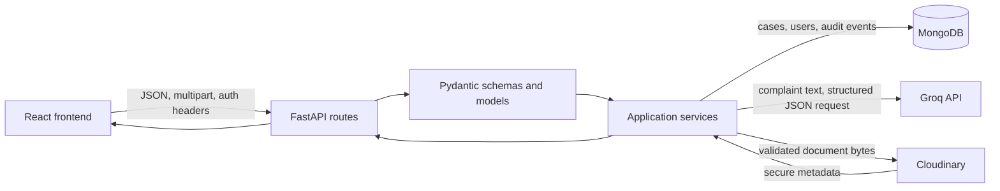

# Backend Architecture and Interview Guide

This document describes the backend implementation in this repository. It is
intended as a code-navigation and interview-preparation guide, not as a claim
that external services have been live-tested.

> **Prototype notice:** This project is an assessment prototype for a
> hypothetical district administration. It is not connected to Tamil Nadu
> Government or any actual government service. Use synthetic data for demos.

## 1. Backend at a glance

The backend is a Python API built with FastAPI and Pydantic. It stores grievance,
user, and audit data in MongoDB through PyMongo. Groq provides optional,
advisory grievance classification. Department routing is deterministic, and
authorized staff remain responsible for review and case decisions. Cloudinary
stores validated document uploads.



### Request layering

1. **API route** parses path, query, header, and request-body values and applies
   FastAPI dependencies.
2. **Schema/model** validates inputs and shapes responses.
3. **Service** performs business rules, authorization checks that depend on the
   loaded record, provider calls, and transaction coordination.
4. **Database adapter** performs focused MongoDB reads and writes.
5. **External provider** is called only by the relevant service; provider
   credentials remain server-side.

## 2. Source tree and responsibilities

| Path | Responsibility |
|---|---|
| `app/main.py` | Constructs the FastAPI app, connects/pings MongoDB at startup, creates indexes, configures CORS, includes routers, and maps validation/database failures to safe responses. |
| `app/core/config.py` | Loads and validates backend environment settings from `backend/.env`; secret values use Pydantic `SecretStr`. |
| `app/api/` | HTTP endpoints and request dependencies. Routes translate domain failures into HTTP responses. |
| `app/schemas/` | Request and response models for grievance operations. |
| `app/models/` | Domain/database models, enums, shared validation, and timestamps. |
| `app/services/` | Business logic for grievances, classification, routing, authentication, and document uploads. |
| `app/database/` | PyMongo connection helpers, collection operations, and index definitions. |
| `app/bootstrap_admin.py` | Interactive, one-time initial administrator creation. |
| `app/seed_admin.py` | Optional environment-configured demo administrator creation without resetting an existing account. |
| `tests/` | Automated tests. This guide describes implementation; it does not report test-suite results. |

### Files used most often

- **API routes:** `app/api/grievances.py`, `app/api/auth.py`, `app/api/health.py`
- **Authentication dependencies:** `app/api/auth_dependencies.py`
- **Validation:** `app/schemas/grievance.py`, `app/models/grievance.py`,
  `app/models/user.py`
- **Core workflow:** `app/services/grievance_management.py`
- **AI:** `app/services/ai_classification.py`
- **Department rules:** `app/services/department_mapping.py`
- **Uploads:** `app/services/document_upload.py`
- **Persistence:** `app/database/grievances.py`, `app/database/users.py`,
  `app/database/indexes.py`

## 3. Main feature flows

### 3.1 Citizen grievance submission and AI classification

**Entry point:** `POST /api/v1/grievances`

1. `app/api/grievances.py::submit_grievance` accepts a
   `GrievanceCreateRequest`.
2. Pydantic validates citizen contact fields and the complaint description.
3. `app/services/grievance_management.py::create_grievance` builds the grievance
   model and generates:
   - a public reference ID via `app/services/reference_id.py`;
   - a single, copy-friendly tracking code via
     `generate_citizen_tracking_code`.
4. The tracking code is returned once in the submission response. Its SHA-256
   digest and 30-day expiry are stored with the grievance; the plaintext code
   is excluded from ordinary model serialization.
5. `classify_complaint` in `app/services/ai_classification.py` is called with
   the complaint description and configured Groq settings.
6. The model suggests category, subcategory, summary, priority, confidence, and
   explanation. It does not choose a department.
7. `recommend_department` in `app/services/department_mapping.py` maps only a
   supported category using fixed configuration.
8. The service marks classification `completed` only when a department mapping
   exists and confidence meets `GROQ_CONFIDENCE_THRESHOLD`. Missing provider
   configuration, provider failures, invalid responses, unsupported categories,
   low confidence, or missing mappings lead to `manual_review`; the grievance
   submission can still be saved.
9. The grievance and `grievance.submitted` audit event are inserted in a MongoDB
   transaction.
10. The API returns the public submission response with the tracking code. Its
    plaintext is returned at submission, while the citizen may reuse it until
    it expires.

**Important distinction:** AI-generated recommendations are advisory. The
deterministic department map and later officer-approved values remain distinct
from the model output.

### 3.2 Citizen case tracking with one code

**Entry point:** `GET /api/v1/grievances/track`, with the tracking code in
`X-Citizen-Tracking-Code`.

1. The citizen enters one code from the submission receipt.
2. `frontend` sends the code in a header; it is not placed in the URL.
3. `app/api/grievances.py::track_grievance_by_code` delegates to
   `get_citizen_tracking_by_code`.
4. `app/services/grievance_management.py` normalizes the code, hashes it, and
   looks up the digest using
   `app/database/grievances.py::get_grievance_by_citizen_token_hash`.
5. The service rejects an unknown or expired code and returns only the permitted
   tracking fields: reference ID, status, AI-processing status, officer-review
   flag, and timestamps. Citizen contact details, complaint text, and internal
   assignment information are not included.
6. The frontend remembers the latest code in `sessionStorage` for the current
   browser tab and offers a copy action on the submission receipt.

The generated format is `CFX-ABCD-EFGH-JKLM-NPQR`. The random portion is made
from 16 cryptographically selected characters using a 32-character alphabet
(80 bits of randomness). The backend stores only a digest and expires the code
after 30 days.

**Earlier submissions:** `GET /api/v1/grievances/{reference_id}/track` remains
available for records created with the earlier reference-plus-access-token
tracking flow.

### 3.3 Staff login, JWT, and role-based access

**Entry points:** `POST /api/v1/auth/login`, `GET /api/v1/auth/me`, and
protected grievance routes.

1. `app/api/auth.py::login` receives validated email/password data.
2. `authenticate_user` normalizes the email, loads the account, and verifies the
   Argon2 password hash. Unknown email and incorrect password produce the same
   public error.
3. `create_access_token` signs a short-lived JWT with HS256, configured issuer,
   user ID subject, issued-at time, and expiration.
4. `app/api/auth_dependencies.py::_resolve_credentials` verifies JWT claims,
   reloads the account, and rejects inactive users.
5. `get_current_user` supplies the resolved server-side user to protected
   routes. Request-body role values do not grant permissions.
6. `require_admin` gates administrator-only account creation.
7. Case services apply department checks using the current case assignment:
   officer-approved department first, then the deterministic recommendation.

Passwords are validated to 12–128 characters at creation and hashed before
storage. Public user responses omit the password hash.

### 3.4 Admin-created accounts and initial administrator

**Admin endpoint:** `POST /api/v1/auth/users`.

1. FastAPI validates `UserCreate`, including normalized email, password length,
   role, and role/department constraints.
2. `require_admin` authenticates and authorizes the caller.
3. `create_user` resolves the department through the configured department map,
   hashes the password with Argon2, and inserts the user.
4. MongoDB's unique email index handles duplicate-email races; duplicate
   accounts become HTTP `409`.
5. `UserResponse.from_user` returns public fields only.

For the first administrator, use `python -m app.bootstrap_admin` from the
`backend` directory for an interactive prompt, or configure the documented
`SEED_ADMIN_*` values and run `python -m app.seed_admin`. Both use the same
authentication service and password hashing.

### 3.5 Staff case list, review, status, and audit

**Endpoints:** `GET /api/v1/grievances`, `GET /api/v1/grievances/{reference_id}`,
`PATCH /api/v1/grievances/{reference_id}/review`,
`PATCH /api/v1/grievances/{reference_id}/status`, and
`GET /api/v1/grievances/{reference_id}/audit-logs`.

- Listing is paginated and can filter by status, priority, and department.
  Officers are restricted to their configured department in the route.
  Service-level filters use officer-approved priority/department where present,
  otherwise AI priority/deterministic department recommendation.
- Case detail loads and validates the stored model, then
  `ensure_grievance_access` enforces admin or officer department access.
- `review_grievance` merges only supplied corrections, validates department
  codes, keeps `officer_approved` separate from `ai_suggestion`, and writes a
  before/after `grievance.reviewed` event in the same transaction.
- `update_grievance_status` checks `ALLOWED_STATUS_TRANSITIONS`, performs a
  conditional update against the old status, and writes a
  `grievance.status_changed` audit event in one transaction. The conditional
  update prevents a concurrent stale transition from silently overwriting a
  newer state.
- `list_grievance_audit_logs` first applies the same case-access check, then
  returns events in chronological order.

Status values are `SUBMITTED`, `UNDER_REVIEW`, `IN_PROGRESS`, `RESOLVED`,
`REJECTED`, and `CLOSED`. The service transition map is authoritative; the
frontend is not the authorization boundary.

### 3.6 Supporting documents

**Endpoint:** `POST /api/v1/grievances/{reference_id}/documents` (multipart).

1. `get_document_uploader` resolves either an authenticated staff user or the
   citizen tracking credential.
2. `upload_document` reads at most 5 MB plus one byte so oversize input can be
   detected without unbounded buffering.
3. `upload_supporting_document` validates filename, extension, MIME type,
   signature bytes, and access to the case.
4. The service sends bytes to Cloudinary under a server-generated public ID and
   requires valid HTTPS response metadata.
5. Document metadata and a `grievance.document_uploaded` audit event are
   persisted transactionally in MongoDB.
6. If remote upload succeeded but metadata/audit persistence fails, a
   compensating Cloudinary deletion is attempted; cleanup errors are logged
   without replacing the original failure.

The accepted formats are PDF, JPG/JPEG, and PNG, with a 5 MB maximum.
Attachments are not processed by OCR or AI.

### 3.7 Health, database lifecycle, and error responses

- `app/main.py::lifespan` creates the MongoDB client, pings it, creates indexes,
  and closes the client during shutdown. If MongoDB is unavailable, the API can
  start in a degraded state; database-dependent routes return HTTP `503`.
- `GET /health` checks the current database connection and returns healthy or
  degraded status.
- `get_database` prevents routes from operating on a missing database handle.
- `handle_request_validation_error` returns `422` while removing rejected input
  values for password fields.
- `handle_mongodb_error` logs a sanitized event and returns a stable `503`
  response without database connection details.

## 4. API route map

All application routes are under `/api/v1`, except `/health`.

| Method | Route | Access | Purpose |
|---|---|---|---|
| `GET` | `/health` | Public | API and MongoDB readiness |
| `POST` | `/api/v1/auth/login` | Public | Authenticate and return JWT/profile |
| `GET` | `/api/v1/auth/me` | Staff JWT | Return current public user profile |
| `POST` | `/api/v1/auth/users` | Admin JWT | Create officer/admin account |
| `POST` | `/api/v1/grievances` | Public | Submit a case and receive tracking code |
| `GET` | `/api/v1/grievances/track` | `X-Citizen-Tracking-Code` | Return limited case progress |
| `GET` | `/api/v1/grievances/{reference_id}/track` | Legacy `X-Citizen-Access-Token` | Track earlier submissions |
| `GET` | `/api/v1/grievances` | Staff JWT | List and filter cases |
| `GET` | `/api/v1/grievances/{reference_id}` | Staff JWT; department scoped | Retrieve case detail |
| `PATCH` | `/api/v1/grievances/{reference_id}/review` | Staff JWT; department scoped | Record officer-approved corrections |
| `PATCH` | `/api/v1/grievances/{reference_id}/status` | Staff JWT; department scoped | Apply an allowed status transition |
| `GET` | `/api/v1/grievances/{reference_id}/audit-logs` | Staff JWT; department scoped | View case audit history |
| `POST` | `/api/v1/grievances/{reference_id}/documents` | Staff JWT or citizen code | Upload a validated supporting document |

Interactive API documentation is available at `/docs` while the local FastAPI
server is running.

## 5. Data and persistence

### MongoDB collections

| Collection | Main data |
|---|---|
| `grievances` | Citizen details, complaint, AI suggestion, processing status, deterministic recommendation, officer-approved values, workflow status, documents, reference ID, timestamps, tracking-code hash and expiry |
| `users` | Normalized email, name, Argon2 password hash, role, optional department, active flag, creation timestamp |
| `audit_logs` | Grievance reference/ObjectId, action, actor, previous/new values, creation timestamp |

Pydantic models in `app/models/` define validation and stored shape. API response
schemas omit internal IDs and credential fields unless specifically needed for
the initial submission response.

### Indexes and transactions

`app/database/indexes.py` creates:

- unique grievance reference ID;
- unique partial index on citizen credential hashes;
- status, department, priority, and creation-time query indexes;
- audit reference/time index;
- unique user email index.

Submission, staff review, status transitions, and document metadata plus audit
events use MongoDB transactions. The configured MongoDB deployment must support
transactions (for example, a replica set).

## 6. Configuration and local operation

### Configuration source

`app/core/config.py` reads `backend/.env` explicitly and caches the validated
`Settings` object. Never commit actual credentials.

| Variable | Used by |
|---|---|
| `MONGODB_URI`, `MONGODB_DB_NAME` | MongoDB connection and selected database |
| `MONGODB_SERVER_SELECTION_TIMEOUT_MS` | MongoDB connection timeout |
| `GROQ_API_KEY`, `GROQ_MODEL` | Optional AI classification provider |
| `GROQ_CONFIDENCE_THRESHOLD`, `GROQ_TIMEOUT_MS` | Classification review threshold and provider timeout |
| `CLOUDINARY_CLOUD_NAME`, `CLOUDINARY_API_KEY`, `CLOUDINARY_API_SECRET` | Document storage |
| `JWT_SECRET_KEY`, `JWT_ACCESS_TOKEN_MINUTES` | Staff JWT signing and expiry |
| `SEED_ADMIN_NAME`, `SEED_ADMIN_EMAIL`, `SEED_ADMIN_PASSWORD` | Optional `seed_admin` command only |

Settings define defaults for model, timeout, threshold, and JWT lifetime. MongoDB,
Groq, Cloudinary, and JWT functionality still require their corresponding
configuration to be set for those features.

### Start the backend

From PowerShell:

```powershell
cd backend
.\.venv\Scripts\Activate.ps1
python -m uvicorn app.main:app --reload --host 127.0.0.1 --port 8000
```

Local URLs:

- API: `http://127.0.0.1:8000`
- Health: `http://127.0.0.1:8000/health`
- Swagger UI: `http://127.0.0.1:8000/docs`

The frontend's local base URL is configured with `VITE_API_BASE_URL` in the
frontend environment. Confirm it points to the backend host and port used for
the demo.

## 7. Interview questions and suggested answers

Use the answers as a starting point and explain the actual implementation in
your own words.

### Q1. Walk me through a grievance submission.

**Suggested answer:** The request enters `submit_grievance` in
`app/api/grievances.py` and is validated by `GrievanceCreateRequest` and nested
Pydantic models. `create_grievance` generates identifiers, requests the advisory
Groq classification, applies the deterministic department mapping, sets the
processing state, and inserts the grievance and submission audit event in one
MongoDB transaction. The API returns the reference and the tracking code; the
code is reusable until its expiry.

### Q2. What happens when Groq is unavailable?

**Suggested answer:** The classification service raises a sanitized
`ClassificationProviderError`. The management service catches that expected
provider failure, marks `ai_processing_status` as `manual_review`, and continues
saving the grievance and audit event. The citizen submission does not depend on
AI success.

### Q3. How is AI output constrained and validated?

**Suggested answer:** The prompt and strict JSON schema are built from the
configured supported categories and priority enum. The response is parsed as
JSON, validated by `GroqAISuggestion`, then validated again by the shared
`AISuggestion` model. A category must canonicalize to a supported category or
the service falls back to manual review. Confidence is a model estimate, not a
calibrated probability.

### Q4. Why is department assignment not delegated to AI?

**Suggested answer:** Department routing is an administrative rule. The AI
returns a supported grievance category, and `recommend_department` maps that
category through a fixed dictionary. Unsupported categories return no
recommendation and require manual review. This keeps assignment deterministic
and reviewable.

### Q5. How does one-code citizen tracking work?

**Suggested answer:** On submission the backend generates a random code, returns
the plaintext once, and stores its SHA-256 digest and expiry. The citizen sends
the code in `X-Citizen-Tracking-Code`; the backend hashes it, looks up the
digest, checks expiry, and returns a restricted tracking schema. The code is not
stored in the database in plaintext or put in the URL.

### Q6. How are officer decisions kept separate from AI suggestions?

**Suggested answer:** The grievance model has separate `ai_suggestion`,
`recommended_department`, and `officer_approved` fields. `review_grievance`
merges the staff's supplied corrections into `officer_approved`, validates
department codes, records before-and-after values in the audit log, and does not
overwrite the original AI suggestion.

### Q7. How do you enforce officer department scope?

**Suggested answer:** The authenticated user is resolved from the signed JWT
and reloaded from MongoDB. The list route forces an officer's assigned
department. Case-specific services call `ensure_grievance_access`, which checks
the officer against the approved department when present, otherwise against
the deterministic recommendation. Admins can access across departments.

### Q8. How does the backend prevent invalid status transitions and races?

**Suggested answer:** `update_grievance_status` checks the current status against
`ALLOWED_STATUS_TRANSITIONS`. It updates the record with a query that includes
the expected old status, then writes the audit event in the same transaction.
If another request changed the status first, the conditional update matches no
record and the service returns a conflict rather than silently overwriting it.

### Q9. How are passwords stored and authentication tokens handled?

**Suggested answer:** `UserCreate` holds the input as `SecretStr` and validates
its length. `_build_user_document` hashes it with Argon2 before insertion.
Successful login issues an HS256 JWT with subject, issuer, issued-at, and expiry.
Protected routes validate those claims and reload the active account. Public
user responses are built through `UserResponse.from_user`, which omits the
password hash.

### Q10. How are document uploads validated and made consistent across providers?

**Suggested answer:** The API reads a bounded number of bytes, and the upload
service checks size, filename, extension, MIME type, and file signature. It
authorizes either the staff actor or citizen credential, uploads to Cloudinary
using a generated identifier, validates the HTTPS metadata, then writes
metadata and an audit event transactionally. If the database transaction
fails, it attempts to delete the Cloudinary asset as a compensating action.

### Q11. Why use MongoDB transactions, and what deployment requirement follows?

**Suggested answer:** A grievance update and its audit event must not diverge.
Transactions make those related writes succeed or roll back together. MongoDB
transactions require a deployment that supports them, such as a replica set;
that requirement should be considered when configuring a local or hosted
database.

### Q12. What is the difference between a route, schema, service, and database
adapter?

**Suggested answer:** A route defines HTTP behavior and dependencies; a schema
validates inputs or shapes outputs; a service owns workflow and business rules;
and a database adapter performs focused persistence operations. For example,
`review_grievance_endpoint` calls `review_grievance`, which validates and
coordinates the change, while `update_grievance` performs the MongoDB write.

### Q13. What are the main limitations of this backend?

**Suggested answer:** It is a synthetic-data prototype, not an actual
government integration. Uploaded documents are stored but are not OCR-processed
or included in AI classification. There is no chatbot, RAG, predictive
analytics, multilingual classification, or autonomous resolution. AI
suggestions remain advisory and require authorized human review.

### Q14. What would you improve before a real deployment?

**Suggested answer:** I would begin with a threat model and security review,
stronger operational configuration and secret rotation, explicit rate limits
and abuse monitoring on public endpoints, provider and database observability,
backup/restore and retention plans, deployment-specific CORS and TLS, and
independent tests for authorization, workflow transitions, provider failures,
and data privacy. I would also replace illustrative department mappings with
approved operational configuration only after the actual service scope is
defined.

## 8. Useful commands

Run commands from the `backend` directory unless noted otherwise.

```powershell
# Start the development API on port 8000
python -m uvicorn app.main:app --reload --host 127.0.0.1 --port 8000

# Bootstrap the first administrator interactively
python -m app.bootstrap_admin

# Create an optional configured demo administrator
python -m app.seed_admin
```

Health and interactive API documentation:

```text
http://127.0.0.1:8000/health
http://127.0.0.1:8000/docs
```

## 9. Accuracy and verification note

This guide was written from source inspection. The documented routes and
business flows describe code paths; they do not prove that MongoDB, Groq, or
Cloudinary credentials are configured or that external provider requests
succeed in a given environment. Validate those integrations separately using
synthetic demo data.
